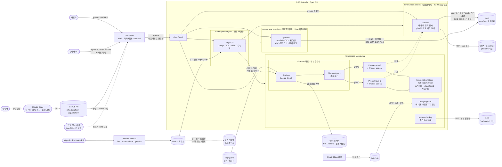

# GKE Autopilot 모니터링 랩

[](https://github.com/windevase/gke-autopilot-lab/actions/workflows/ci.yml)

월 **$10 크레딧 안에서** 운영하는 GKE Autopilot 클러스터에 kube-prometheus-stack(Prometheus + Grafana)을 올리고,
Cloudflare Tunnel로 외부에 공개한 포트폴리오용 실습 환경입니다.
인프라는 Terraform, 클러스터 안 워크로드는 **Argo CD(GitOps)** 로 관리합니다. Git에 push하면 Argo CD가 클러스터를 Git과 일치시킵니다.
클라우드 리소스 변경(이 저장소의 `platform/` 계층, 별도 저장소의 AWS 프로젝트)은 클러스터 안의 **Atlantis**가 PR 단위로 plan·apply합니다.
사람은 채팅으로만 승인하고, AI 에이전트가 PR 작성·보고·승인 기록을 맡으며, 감시·사후 감사가 그 과정을 강제합니다 ([Terraform CI/CD](#terraform-cicd-atlantis--채팅-승인)).
역할을 붙일 수 없는 서버(온프레미스 등)와 담당자 PC 는 **OpenBao**에서 AWS 임시 자격을 받아 **액세스 키 없이** 동작합니다 ([임시 자격 발급](#임시-자격-발급-openbao)).

**목표:** 운영 품질(보안·관측성·자동화)은 지키면서 비용은 최소로 유지합니다. 예상 비용은 **월 약 $5.3**입니다 (Prometheus 이중화 + Thanos, Argo CD, Atlantis, OpenBao 포함).

> **저장소 구성:** 운영은 private 저장소에서 하고, 공개 저장소 [gke-autopilot-lab](https://github.com/windevase/gke-autopilot-lab)에는 검사를 통과한 **스냅샷**만 올립니다.
> 공개본에서는 계정 식별 정보(프로젝트 ID·도메인·계정 ID 등)를 `my-gcp-project`, `example.com` 같은 예시 값으로 바꾸고,
> private 토큰이 있어야 동작하는 워크플로(승인 후 apply, 사후 감사)는 제외했습니다.

## 구성



| 구성 요소 | 내용 |
|---|---|
| 클러스터 | GKE Autopilot, us-central1, REGULAR 채널. 모든 워크로드는 **Spot Pod** |
| 모니터링 | kube-prometheus-stack (Prometheus, Grafana, kube-state-metrics). Alertmanager와 기본 대시보드·규칙은 제거 |
| 고가용성 | Prometheus 2대(서로 다른 Spot 노드) + Thanos Query로 병합·중복 제거 → Spot 회수 1건으로는 수집 공백 없음 |
| 대시보드 | 직접 만든 8종 (아래 표) |
| 외부 공개 | Cloudflare Tunnel (공인 IP·로드밸런서 없음) |
| 비용 보호 | 예산 초과 시 워크로드를 자동으로 0으로 내리는 kill switch (월 1회 자가 점검) |
| GitOps | Argo CD App of Apps. 관리자 PC IP + Google 로그인 + RBAC 승인제 |
| 백업 | Grafana DB를 매주 GCS로 (생성 권한만, 60일 보관) |
| IaC | Terraform (GCP + Cloudflare), Helm values, Kubernetes 매니페스트. 계층 분리: bootstrap(클러스터·권한, 로컬) / `platform/`(Atlantis) |
| Terraform CI/CD | **Atlantis**(클러스터 안, 필요할 때만): PR 단위 plan → 채팅 승인 → apply → 자동 merge. 이 저장소 `platform/` + 별도 AWS 저장소 |
| 임시 자격 발급 | **OpenBao**(클러스터 안, 필요할 때만): 역할 없는 서버는 AppRole(IP 고정), 담당자는 OIDC 로그인 → AWS STS 15분~1시간. OpenBao 자신도 키 없음(IRSA) |
| 변경 통제 | 무료 GitHub(브랜치 보호 없음)를 규칙으로 보완: 채팅 승인 기록 · 서버 측 감시 · main 사후 감사 · 저장소 간 교차 감사 · AI 거부 목록 |
| CI · 버전 관리 | GitHub Actions: Terraform fmt/validate, kubeconform(Helm 렌더링 포함), gitleaks, 대시보드·스크립트 검사. Renovate·Dependabot이 업데이트 PR 생성 |

### 대시보드

기본 대시보드는 모두 제거하고, 필요한 것만 **코드로** 관리합니다 (아래 [Dashboard as Code](#dashboard-as-code)).

| 대시보드 | 데이터 | 내용 |
|---|---|---|
| **홈** | BigQuery + Prometheus | 로그인 첫 화면. 순 청구액·예산 대비·월말 예상, 클러스터·터널·자동 차단 상태 요약과 대시보드 바로가기 |
| **비용 & 용량** | Prometheus | 파드 requests 기반 월 비용 추정, 컨테이너별 사용률(rightsizing), Prometheus 상태 |
| **클러스터 성능** | Prometheus | 노드·워크로드(CPU·메모리·스로틀링·네트워크·디스크), PV, API 서버 요청·지연, 수집 상태 |
| **운영 & 외부 접속** | Prometheus | 워크로드 가동 타임라인(오프아워·자동 차단 효과), CronJob 상태, Spot 노드 교체 이력, Cloudflare Tunnel 요청·오류·RTT·트래픽 |
| **실제 청구액** | BigQuery | 이번 달 사용액·크레딧·순 청구액·예산 대비·월말 예상, **추정 vs 실제**, 서비스·SKU별 상세 |
| **Argo CD (GitOps)** | Prometheus | 앱별 Sync/Health 현재 상태·타임라인, 동기화 횟수·결과·소요 시간, reconcile 시간, 컨트롤러 캐시 객체 수(메모리와 직결), Git 요청, 리소스·재시작·OOM |
| **Terraform CI/CD** | Prometheus + GitHub | 사후·교차 감사 마지막 결과, Atlantis 가동 시간·비용(7일), plan·apply 실행 결과(24시간), PR 리드타임, 워크플로 결과, 정책 위반 이슈 |
| **GitHub 사용량** | GitHub REST (Infinity) | GitHub Free 무료 한도 대비 Actions 분(Linux 환산)·저장 공간(GB-시간)·월말 예상·청구 예정, 캐시, API 요청 한도 |

## Dashboard as Code

Grafana UI에서 대시보드를 직접 고치지 않고, **모든 대시보드를 Git의 파일로 관리**합니다.

```
gen_*.py (Python 생성기, 공통 모듈 _dashlib.py)
   │  python gen_ops_dashboard.py lab-ops.json
   ▼
lab-*.json (Grafana 대시보드 JSON)
   │  kubectl create configmap ... | kubectl label grafana_dashboard=1
   ▼
lab-*.configmap.yaml ──git push──▶ Argo CD 동기화 ──▶ Grafana 사이드카가 30초 안에 자동 반영
```

| 원칙 | 내용 |
|---|---|
| **단일 원천** | 패널·쿼리·임계값·설명은 생성기 코드에만 있음. UI에서 바꾼 내용은 다음 배포 때 덮어씀 |
| **재사용** | 패널 함수(stat, timeseries, table 등)와 공통 쿼리(결제 SQL, 터널 오류율)를 `_dashlib.py` 한곳에서 관리 → 대시보드끼리 같은 숫자가 다르게 계산되는 일이 없음 |
| **CI 검증** | push마다 ① 생성기를 다시 실행한 결과 = 커밋된 JSON, ② ConfigMap = JSON 인지 검사. 생성기만 고치고 JSON을 안 바꾸거나, ConfigMap 재생성을 잊으면 CI가 실패 |
| **수집과 한 쌍** | 지표는 대시보드가 쓰는 것만 keep → 새 패널에 지표가 필요하면 `values.yaml` keep 목록에도 추가 |
| **쿼리 비용 고려** | 숫자 하나만 보여 주는 패널은 instant 쿼리 (Prometheus 처리 샘플 83~138배 감소 실측), 결제 대시보드는 BigQuery 과금(쿼리당 최소 10MB)을 고려해 1시간마다 새로고침 |
| **식별 정보 없음** | BigQuery 쿼리는 데이터소스 기본 프로젝트를 써서 코드에 프로젝트 ID가 없음 |

## AI 협업 운영 (AIOps 워크플로)

**인프라 기획과 설계는 사람이, 실제 작업은 AI 코딩 에이전트(Claude Code)가** 수행했습니다.
에이전트가 터미널에서 gcloud·kubectl·Terraform·Prometheus API·BigQuery를 직접 다루며 구현·측정·검증을 맡고,
선택지가 있을 때는 비교안을 제시합니다. 무엇을 채택할지는 사람이 결정했습니다.

| 역할 | 사람 | AI (Claude Code) |
|---|---|---|
| 기획·목표 | 월 $10 크레딧 안 운영, 포트폴리오 범위, 기능 우선순위 결정 | — |
| 아키텍처·설계 | GKE Autopilot·Spot, Cloudflare Tunnel 공개, 예산 초과 자동 차단, Operator 평소 0, 지표 keep 리스트, 관리자 승인 로그인 등 방향 결정 | 결정에 필요한 비교안 제시 (비용·제약·위험) |
| 구현 | 결과 검토·승인 | Terraform 모듈, Helm values, 매니페스트, 대시보드 생성기, CI 작성·적용 |
| 운영·분석 | 판단과 최종 승인 | 비용 이상 탐지, 실측, 장애 원인 규명, 변경 후 검증 |

| AI가 수행한 작업 예시 | 내용 |
|---|---|
| **비용 이상 탐지와 원인 분석** | 결제 SKU와 `billing/samples_ingested` 지표로 관리형 Prometheus 과금(방치 시 월 약 $20)을 찾아 차단. 결제 보고서의 SKU를 하나씩 대조해 노드 외부 IP 과금이 없음을 확인 |
| **실측 기반 최적화** | 컨테이너별 사용량 대비 requests 비교, 대시보드가 쓰는 지표 역추적으로 시계열 90% 감축, 쿼리별 응답 시간·처리 샘플 수 측정으로 instant 쿼리 전환 |
| **설계 결정의 구현** | 예산 kill switch(컨트롤 플레인 IP 제한을 고려한 클러스터 내부 CronJob), Operator 없이 동작하는 kubelet 노드 탐색, 대시보드 생성기·CI |
| **장애 대응** | Grafana ChunkLoadError → Cloudflare rate limit(Error 1015) 원인 규명, 터널 오류율 지표가 브라우저 요청 취소까지 세던 문제 수정, Thanos·Argo CD 컨트롤러 OOM의 원인(원본 샘플 적재·클러스터 전체 캐시)을 찾아 메모리 증설 대신 구조로 해결 |
| **사고 예방** | 결제 보고서와 예산 금액을 대조해, 실제 청구 0원인데 kill switch가 사흘 뒤 모니터링을 내릴 상황을 미리 발견·수정 |
| **안전한 전환** | Helm으로 운영하던 스택을 Argo CD로 넘기기 전에 렌더링 결과를 클러스터와 diff(차이 0)로 확인, 부하 테스트(보관 기간 전체 × 동시 40개)로 메모리 산정 |

**안전장치**

- **사람 승인:** 클러스터·DNS·보안 규칙 변경, 저장소 삭제, 원격 기록 덮어쓰기(force push) 같은 되돌리기 어려운 작업은 실행 전에 사람이 승인
- **비밀값 비노출:** 토큰·키는 파일에서 읽어 헤더·환경변수로만 쓰고 화면이나 로그에 출력하지 않음
- **검증 후 보고:** 변경 후 `terraform plan`(No changes), 대시보드 쿼리 전수 실행, CI 통과를 확인하고 결과를 보고
- **맥락 유지:** 운영 결정과 남은 작업을 로컬 작업 노트로 관리해 세션이 바뀌어도 이어서 작업 (계정 정보가 있어 저장소에는 포함하지 않음)
- **CI가 최종 관문:** AI가 만든 변경도 사람이 만든 변경과 똑같이 CI(형식·스키마·비밀값·대시보드 일치)를 통과해야 함
- **채팅 승인 + 거부 목록:** 클라우드 변경은 AI 보고 → 사람 채팅 승인 → 그 커밋에만 apply. 되돌리기 어려운 작업은 사람이 승인해도 AI가 거부하도록 권한 설정으로 강제

## GitOps (Argo CD)

클러스터 안 워크로드는 **Git이 원본**입니다. `k8s/apps/`의 루트 Application이 컴포넌트별 Application을 관리하는
**App of Apps** 구조이고, 각 앱은 자동 동기화(prune, selfHeal)로 Git과 클러스터를 일치시킵니다.

| 앱 | 내용 |
|---|---|
| `kps` | kube-prometheus-stack (공식 차트 + Git의 values, 멀티 소스) |
| `cloudflared` | Cloudflare Tunnel 커넥터 |
| `budget-guard` | 예산 초과 자동 차단 + 월간 자가 점검 |
| `backup` | Grafana DB 주간 백업 |
| `offhours` | 평일 주간만 가동하는 스케일러 (Grafana·cloudflared·Argo CD) + Atlantis 20:00 자동 종료 |
| `atlantis` | Atlantis(공식 차트 + 서버 측 정책·감시 스크립트·AWS 프로필 ConfigMap) |
| `platform` | StorageClass, NetworkPolicy |
| `dashboards` | Grafana 대시보드 ConfigMap |

| 설계 | 내용 |
|---|---|
| **접근 제어 3단** | Cloudflare WAF로 관리자 PC IP만 → Google 로그인(로컬 ID/비밀번호 폼 없음) → RBAC 기본 권한 없음, 관리자만 admin. 다른 사용자 승인은 RBAC 정책에 이메일을 추가하는 **Git 커밋**으로 남음 |
| **운영 정책과 공존** | replicas는 오프아워 스케일러·예산 차단·"Operator 평소 0"이 정하므로 `ignoreDifferences`로 Argo가 되돌리지 않음 |
| **비용** | Dex·Notifications·ApplicationSet 제거, Spot, 평일 주간만 가동 (월 약 $1) |
| **컨트롤러 경량화** | 감시 범위를 사용하는 네임스페이스로 제한, CRD 캐시 제외, 동시 처리 축소 → 기본 설정의 OOM(512Mi 초과)을 170~320Mi로 |
| **안전한 전환** | 기존 리소스를 넘겨받기 전에 렌더링 결과와 클러스터를 diff로 비교(차이 0 확인) 후 수동 동기화 → 그 뒤 자동 동기화 활성화 |
| **상태 가시화** | 컨트롤러·repo-server 지표(약 90개 시계열)로 전용 대시보드 구성: 앱 Sync/Health·동기화 이력·소요 시간·캐시 객체 수·Git 요청 (홈: 비정상 앱 수) |
| **Argo CD 자신** | Argo CD는 Argo로 관리하지 않음 (부트스트랩 순환 방지). `k8s/argocd/install.ps1`(Helm, 차트 버전 고정)로 설치·업그레이드 |
| **CRD 분리** | kps 차트의 CRD(수 MB)는 `skipCrds`로 Argo가 다루지 않음 → 차트 업그레이드 때만 수동 적용 (Renovate PR 본문에 자동 안내) |
| **버전 업데이트** | Renovate가 차트·이미지 새 버전을 PR로 생성 → CI 검증 → 머지하면 Argo CD가 배포. 같은 차트가 여러 파일(Argo 앱·CI·스크립트)에 있어도 한 PR로 묶음 |

## Terraform CI/CD (Atlantis · 채팅 승인)

클라우드 리소스 변경은 **PR → plan → 사람 승인 → apply** 를 거칩니다. GitHub Actions의 승인 게이트(Environment)는
무료 private 저장소에서 쓸 수 없어, 같은 일을 클러스터 안의 Atlantis와 규칙으로 구현했습니다.

```
요청(전자결재 기안·지시) ─▶ Claude Code: 코드 작성 → 봇 이름 PR
   ─▶ Atlantis autoplan(plan 첫 단계 사전 검사 → plan → plan 감시 보고) + CI(코드 감시·테스트)
   ─▶ Claude: 리소스별 동작·이름 근거·감시 결과·커밋 SHA 를 채팅으로 보고 ─▶ 담당자: 채팅으로 승인
   ─▶ Claude: 그 커밋에 승인 기록(chat-approve.sh) ─▶ apply 직전 재검사 ─▶ Atlantis apply ─▶ 자동 merge
   ─▶ main 사후 감사 · 매일 교차 감사
```

| 보장 | 구현 |
|---|---|
| **승인한 커밋만 apply** | 서버 측 정책(approved·mergeable·undiverged) + apply 직전 감시가 "마지막 승인 커밋 = apply 커밋", 승인자·해제 라벨 부착자 = 담당자, 필수 CI 성공, 보호 경로 혼합 없음을 확인 |
| **승인 전 실행되는 코드 차단** | autoplan은 승인 전에 PR 코드를 실행하므로 plan 첫 단계에서 provisioner·외부 명령·허용 밖 provider·원격 모듈·파일 함수 절대 경로·provider 인증 인자·심볼릭 링크를 차단(서버 측 사본 — PR이 우회 불가), init은 lock 파일 고정, AWS plan은 **읽기 전용 역할** |
| **위험 변경 감시** | plan 결과에서 삭제·교체, 공개 인바운드, IAM 와일드카드·관리자 정책, 공개 버킷·키 생성 등을 찾아 보고하고 apply 때 다시 막음(해제 라벨은 담당자 지시로만, 일부는 해제 불가) |
| **승인 없는 정책 변경 탐지** | 감시·워크플로·도구·지침·Argo 앱 정의(보호 경로)를 바꾼 merge는 main 사후 감사가 **변경 전 버전 스크립트로** 승인 기록을 확인, 없으면 이슈 + 되돌림 브랜치. 두 저장소가 매일 서로의 감사 파일·승인 기록을 교차 감사 |
| **AI 경로 통제** | Claude Code 권한 설정이 main 직접·force-push, 직접 merge, destroy·`-auto-approve`, state 편집, 감사 끄기를 **사람이 승인해도** 실행하지 않음 |
| **검증** | 감시 규칙 회귀 테스트, 승인·감사 스크립트 동작 테스트(가짜 GitHub 응답으로 58개 시나리오), 독립 검토로 우회 경로 점검 |

| 운영 | 내용 |
|---|---|
| 가동 | 평소 replicas 0, 처리할 때만 `tools\atlantis.ps1 on` (꺼져 있던 동안의 PR은 켤 때 자동 재plan), 매일 20:00 자동 종료 |
| 인증 | 키 없음 — AWS는 GKE OIDC 신뢰 역할(plan/apply 분리), GCP는 Workload Identity + IAM 조건, Cloudflare는 전용 최소 권한 토큰 |
| 외부 경로 | Cloudflare Tunnel로 `/events` 웹훅만, WAF로 GitHub hooks IP·POST만 허용. UI는 외부 비공개 |
| 관측 | Atlantis 지표(ServiceMonitor) + GitHub PR·Actions 이력 → Terraform CI/CD 대시보드 |

## 임시 자격 발급 (OpenBao)

액세스 키를 나눠 주지 않고, **신원을 확인한 뒤 수명이 짧은 자격을 그때그때 발급**합니다. 클라우드 서버·파드는 원래 역할(IRSA·Workload Identity)을 쓰고,
OpenBao 는 **역할을 붙일 수 없는 곳**(온프레미스 서버, 담당자 PC)을 맡습니다. 정책 원본은 AWS 저장소 `docs/policy/access.md`.

```
역할 없는 서버: role_id + secret_id(이 서버 IP 에서만) ─▶ AppRole 로그인 ─┐
담당자 PC:      브라우저 OIDC 로그인(Google, 회사는 Entra ID) ─────────────┤
                                                                         ▼
                OpenBao ─(IRSA, 키 없음)─▶ AWS 중개 역할 ─▶ 대상 역할 STS (15분~1시간)
                                                                         ▼
                aws CLI·SDK ◀─ credential_process(만료 5분 전까지 캐시 재사용)
```

| 항목 | 구성 |
|---|---|
| 배포 | Argo 앱 `openbao`(공식 차트), 1대 Raft·Spot. **필요할 때만 가동** — `tools/atlantis.ps1 on/off` 가 Atlantis 와 함께 켜고 끄고, 20:00 오프아워 Job 이 끔 |
| 봉인 해제 | static seal(수동 Secret) — 재시작해도 자동 unseal. 클라우드 KMS 는 쓰지 않음(회사 환경도 동일) |
| 외부 경로 | 같은 Cloudflare Tunnel 의 `bao.*` + WAF(관리자 PC IP 만) + NetworkPolicy(cloudflared → 8200 만) |
| 플러그인 | OpenBao 2.x 는 AWS 엔진이 내장이 아님 → 공식 플러그인을 설정에 **digest 고정**으로 선언(기동 때 다운로드, 실패 시 기동 실패) |
| 감사 | 설정에 선언(API 로 끌 수 없음), 모든 요청을 실제 호출자 IP 와 함께 파드 로그로 |
| 권한 | 서버용 AppRole 은 필요한 권한만(시범: S3 읽기), 관리자 STS 는 사람 OIDC 로그인에만. 루트 토큰은 초기 설정 후 폐기 |
| 검증 | 키 없이 STS 발급·호출, 권한 밖 동작 거부, 래핑 토큰 재사용 거부, 다른 주소에서 AppRole 로그인 거부, `aws` 10회 → 발급 1회(캐시) |

## Prometheus 고가용성 (HA pair + Thanos)

Spot Pod는 언제든 회수될 수 있어, Prometheus가 1대면 회수·재시작 동안(보통 2~5분) 지표가 비었습니다.
Prometheus에는 클러스터링 기능이 없으므로, 표준 패턴인 **같은 Prometheus 2대가 같은 대상을 각자 수집하는 HA pair**를 쓰고
조회 쪽에서 Thanos Query로 합칩니다.

| 설계 | 내용 |
|---|---|
| **노드 분리** | `topologySpreadConstraints`(hostname, `DoNotSchedule`, `minDomains: 2`) → 두 레플리카를 다른 Spot 노드에 강제 배치. Spot 노드가 1대뿐이면 Autopilot이 노드를 하나 더 만듦 |
| **중복 제거** | Operator가 붙이는 외부 레이블 `prometheus_replica`를 Thanos Query의 replica label로 지정 → 같은 시계열을 하나로 합치고, 한쪽 공백은 다른 쪽 데이터로 메움 |
| **Thanos Query 위치** | 별도 파드 대신 **Grafana 파드의 사이드카**. 조회하는 쪽이 Grafana뿐이라 Grafana와 함께 오프아워에 꺼져도 무방 (수집·저장은 Prometheus + sidecar가 24시간). 별도 Deployment 대비 월 약 $0.6 → $0.05 |
| **장기 보관 없음** | 오브젝트 스토리지 업로드는 쓰지 않고 sidecar는 gRPC 조회(StoreAPI)만 제공. 보관 기간은 Prometheus 7일 그대로 |
| **비상 경로** | Thanos 장애 시를 위해 Prometheus Service를 직접 보는 데이터소스를 따로 둠 (`sessionAffinity: ClientIP`로 한 대 고정) |
| **쿼리 최적화** | Thanos Query는 원본 샘플을 레플리카 2대분 메모리에 올리므로, 시계열이 많은 apiserver 지표(히스토그램 1,260개)는 **recording rule**로 미리 집계(→ 7개). PromQL 엔진은 스트리밍 방식 `thanos` 엔진, 동시 실행 4개 제한. Grafana는 incremental querying으로 새로고침 때 새 구간만 조회 |
| **검증** | 대시보드 5종의 쿼리 95개를 보관 기간 전체(7일) 범위로 40개 동시 실행해 오류·재시작 0, cgroup 최대 메모리로 requests 결정 |
| **비용** | 지표 감축 후 실측(메모리 최대 239Mi)으로 requests를 768Mi → 384Mi로 낮춰서, 2대 + Thanos가 1대 시절보다 월 약 $0.6만 증가 |

## 비용을 줄인 방법

| 방법 | 효과 |
|---|---|
| **Spot Pod + requests 실측 기반 최소화** | Autopilot은 파드 requests 기준 과금. 메모리:CPU 비율 제약(최대 6.5GiB/vCPU)과 최소값(CPU 50m)까지 고려해 조정 |
| **수집 지표 keep 리스트** | 대시보드가 쓰는 지표만 수집. 활성 시계열 약 5.2만 → 약 4.6천 (-90%) |
| **관리형 Prometheus 수집 차단** | Autopilot 기본 수집 패키지를 끔. 그대로 두면 월 약 $20이 과금되던 항목 |
| **Prometheus Operator 평소 0** | 설정을 바꿀 때만 켬. kubelet 수집은 Operator가 아닌 Prometheus 자체 노드 탐색으로 바꿔 노드 교체에도 영향 없음 |
| **오프아워 스케일링** | Grafana·cloudflared·Argo CD는 평일 10~20시(KST)만 가동하고 Prometheus는 24시간 수집 |
| **조회 컴포넌트는 조회할 때만** | Thanos Query를 별도 파드 대신 Grafana 파드 사이드카로 → Grafana와 함께 꺼짐 |
| **임시 스토리지 요청 축소** | Autopilot 기본값(컨테이너당 1Gi) → 100Mi |
| **LB 대신 Cloudflare Tunnel** | 로드밸런서 + 고정 IP(월 약 $22) 대신 파드 1개(월 약 $0.16) |
| **무료 등급 활용** | 클러스터 관리비(GKE 무료 티어), 표준 PD 30GB, BigQuery·Pub/Sub·Logging 무료 한도 |

### 월 예상 비용

| 항목 | 월 비용 |
|---|---|
| Prometheus 2대 + Thanos sidecar (24시간) | 약 $2.63 |
| kube-state-metrics (24시간) | 약 $0.55 |
| Grafana + Thanos Query (평일 10시간) | 약 $0.65 |
| cloudflared (평일 10시간) | 약 $0.16 |
| Argo CD 4개 컴포넌트 (평일 10시간) | 약 $1.0 |
| CronJob (budget-guard 매시간, 백업 주 1회, 자가 점검 월 1회, 오프아워) | 약 $0.05 |
| Atlantis (켜 둔 시간만, 비 Spot 250m/1Gi ≈ $0.016/h) + PVC 2Gi | 약 $0.1~0.3 |
| OpenBao (켜 둔 시간만, Spot 50m/256Mi) + PVC 1Gi | 약 $0.05~0.1 |
| PV, 로깅, BigQuery, Pub/Sub, GCS 백업, Cloudflare | 약 $0 (무료 등급) |
| **합계** | **약 $5.3** |

## 보안

- **컨트롤 플레인:** 허용된 IP에서만 API 서버 접근 (authorized networks)
- **외부 노출 경로는 터널 하나:** Service는 ClusterIP뿐이고, Grafana는 NetworkPolicy로 cloudflared 파드에서 오는 트래픽만 허용
- **NetworkPolicy:** 기본 인바운드 차단. Prometheus(9090, Thanos gRPC 10901)는 Grafana 파드에서만, exporter는 Prometheus에서만 접근
  - argocd 네임스페이스도 기본 차단. argocd-server는 cloudflared에서만, repo-server·redis는 Argo 내부 컴포넌트에서만
    (차트 기본 server 정책은 인바운드 전체 허용이라 끄고 직접 정의)
- **Pod Security:** 네임스페이스 `restricted` (runAsNonRoot, seccomp, capabilities drop) — monitoring, argocd 모두
- **Grafana 로그인:** Google OAuth만 사용(ID/비밀번호 폼 숨김). **관리자 승인제**로, 미리 등록된 계정만 로그인
- **Argo CD 접근:** ① Cloudflare WAF 규칙으로 관리자 PC 공인 IP(IPv4 + IPv6 /64)만 → ② Google OIDC만(로컬 admin 비활성화, 로그인 폼 없음) →
  ③ RBAC 기본 권한 없음, 관리자만 admin. 승인은 RBAC 정책에 이메일을 추가하는 Git 커밋
- **Git 접근:** Argo CD는 **읽기 전용** deploy key로만 저장소를 읽음 (클러스터에서 저장소로 쓰기 불가)
- **Cloudflare:** 국가 제한, rate limit (Grafana·Argo CD는 패널·API 요청이 많아 rate limit 예외, Argo CD는 IP 제한으로 대체)
- **키 없는 인증:** Grafana(BigQuery), budget-guard(Pub/Sub), 백업(GCS)은 Workload Identity Federation 사용. 서비스 계정 키 파일 없음
- **최소 권한:** 백업 계정은 GCS 생성만(덮어쓰기·삭제 불가), budget-guard는 차단 대상 5개 객체만 patch, 오프아워 스케일러는 대상 Deployment/StatefulSet의 scale만
- **비밀값·환경 정보:** 저장소에 포함하지 않음. 비밀값은 Kubernetes Secret·로컬 파일·환경변수로, 계정 ID·허용 IP 등은 `terraform.tfvars`(Git 제외)로 관리
- **CI 비밀값 스캔:** push마다 gitleaks로 전체 커밋 기록 검사
- **공개 저장소:** 운영 저장소를 그대로 공개하지 않고, 식별 정보 치환 + 잔존·비밀값 검사를 통과한 스냅샷만 별도 저장소로 (`tools/publish-public.sh`)
- **Atlantis:** 외부에는 웹훅 경로만(GitHub IP·POST), 저장소가 workflow·정책을 덮어쓸 수 없는 서버 측 설정, plan은 읽기 전용 AWS 역할, 감시 스크립트는 클러스터 ConfigMap(PR이 고칠 수 없음)
- **변경 통제:** 원본·사본 스크립트 동일성 CI, main 사후 감사·교차 감사, AI 에이전트 거부 목록(권한 설정으로 강제)
- **OpenBao:** 외부에는 관리자 PC IP 만(WAF), 서버 로그인은 IP 고정 AppRole, 관리자 권한은 사람 OIDC 로그인에만, 감사 로그는 설정 선언(끌 수 없음), 루트 토큰 폐기, 플러그인 digest 고정, 평소 꺼 둠(공격 표면 없음)

## 백업

대시보드·설정은 Git이 원본이지만, Grafana DB(사용자, 승인 목록, 서비스 계정 토큰)는 PV에만 있습니다.
매주 CronJob이 PV를 **읽기 전용**으로 마운트해 sqlite 온라인 백업으로 일관된 사본을 만들고, 무결성 검사 후 GCS에 올립니다.
업로드 계정은 **생성 권한만** 있어 기존 백업을 덮어쓰거나 지울 수 없고, 60일 뒤 수명 주기 규칙으로 정리됩니다 (무료 등급 내).

| 항목 | 내용 |
|---|---|
| 저장소 | Terraform `modules/grafana-backup` — GCS(us-central1 Standard, 공개 차단, 60일 후 삭제) |
| 실행 | `k8s/monitoring/backup` — 매주 수 12시(Grafana 가동 시간). RWO 디스크라 podAffinity로 Grafana 파드와 같은 노드에서 마운트 |
| 검증 | 백업마다 `PRAGMA integrity_check`, 사용자 수를 로그에 남김. 실패하면 Job 실패로 운영 대시보드 CronJob 표에 표시 |
| 복구 | Grafana를 0으로 내림 → 최신 백업을 내려받아 PV의 `grafana.db` 교체 → 다시 1로 (절차는 매니페스트 주석) |

## 예산 자동 차단 (kill switch)

1. Cloud Billing 예산이 비용이 갱신될 때마다 Pub/Sub로 알림을 발행합니다.
2. 클러스터 안의 `budget-guard` CronJob이 매시간 알림을 가져와 **이번 달 사용액 ≥ 예산**인지 확인합니다.
3. 초과했다면 Grafana, cloudflared, kube-state-metrics, Prometheus를 0으로 내리고 아침 자동 기동도 정지합니다.
4. **월 1회 자가 점검**: 같은 스크립트가 Pub/Sub 인증(메시지는 ack하지 않고 반납)과 차단 대상 권한(서버 측 dry-run PATCH)을 확인합니다. 정작 필요할 때 동작하지 않는 상황을 막기 위한 장치이고, 결과는 홈 대시보드에 표시됩니다.

컨트롤 플레인이 허용 IP로 제한돼 있어 Cloud Functions에서는 클러스터에 접근할 수 없습니다. 그래서 클러스터 **안에서** 처리하도록 설계했습니다. RBAC는 차단 대상 객체 5개에만 patch 권한을 줍니다.

**예산 기준:** 사용액에서 무료 등급·할인은 빼고 **Developer Program 크레딧(프로모션)만 빼지 않은 금액**으로 판단합니다.
"월 크레딧을 얼마나 쓰고 있는지"가 기준이기 때문입니다. 처음에는 무료 등급(FREE_TIER)만 뺐는데, GKE 관리비(하루 약 ₩3,400)는
결제 보고서에서 전액 상쇄되는데도 예산에는 그대로 잡혀 **실제 청구 0원인데 사흘 뒤 차단될 상황**이었습니다. 보고서와 예산 금액을 대조해 발견하고 필터를 고쳤습니다.

## 디렉터리 구조

```
.
├─ main.tf, variables.tf, outputs.tf # bootstrap 계층: 클러스터·예산 차단·Atlantis 권한 (로컬 tf.ps1, GCS 원격 state)
├─ platform/                         # platform 계층: 터널·결제 내보내기·백업 버킷 (Atlantis 가 plan·apply, 별도 state)
├─ atlantis.yaml                     # Atlantis 프로젝트(platform) — workflow·정책은 서버 측
├─ terraform.tfvars.example          # 환경별 값 예시 → terraform.tfvars 로 복사 (Git 제외)
├─ backend.hcl.example               # state 버킷 예시 → backend.hcl 로 복사 (Git 제외)
├─ tf.ps1                            # Terraform 래퍼 (Cloudflare 토큰 주입, init 시 backend.hcl 사용)
├─ .github/workflows/ci.yml          # 정적 검증 CI
├─ .github/workflows/apply-on-approve.yml, policy-audit.yml  # 승인 후 apply·merge, main 사후 감사·교차 감사 (공개본 제외)
├─ .github/scripts/policy-audit.sh   # 사후 감사 스크립트 (보호 경로 변경의 승인 기록 확인)
├─ renovate.json                     # 차트·이미지 버전 업데이트 PR (Actions는 Dependabot)
├─ tools/update-myip.ps1             # 공인 IP 변경 시 컨트롤 플레인 허용 IP + WAF 규칙 갱신
├─ tools/atlantis.ps1                # Atlantis(+ OpenBao) on/off/status/replan
├─ tools/bot-pr.sh, chat-approve.sh  # 봇 PR, 채팅 승인 기록·merge (원본: AWS 저장소, 동일 사본)
├─ tools/pr-report.py                # PR plan 결과를 채팅 보고용으로 요약
├─ tools/waf-atlantis.py             # Cloudflare WAF: Atlantis 호스트는 GitHub 웹훅 IP·경로만 (멱등)
├─ tools/publish-public.sh           # 공개용 스냅샷 생성·검사·push (식별 정보 치환)
├─ modules/
│  ├─ gke/                 # Autopilot 클러스터, VPC, 노드 SA, 예산
│  ├─ billing-export/      # BigQuery 결제 내보내기 데이터셋 + Grafana 읽기 권한
│  ├─ budget-guard/        # kill switch용 Pub/Sub 토픽/구독 + IAM
│  ├─ grafana-backup/      # Grafana DB 백업 GCS 버킷 + 업로드 권한
│  ├─ cloudflare-tunnel/   # Cloudflare Tunnel + DNS
│  └─ atlantis-gcp-access/ # Atlantis 의 GCP 권한 (Workload Identity + IAM 조건)
└─ k8s/
   ├─ argocd/              # Argo CD values + install.ps1 (Argo CD 자신은 Helm으로 부트스트랩)
   ├─ apps/                # App of Apps: root + 컴포넌트별 Application
   ├─ atlantis/            # Atlantis values(서버 측 정책·workflow), 감시 스크립트·AWS 프로필 ConfigMap, NetworkPolicy
   ├─ openbao/             # OpenBao values(static seal·AWS 플러그인 digest·감사 선언·IRSA·NetworkPolicy)
   └─ monitoring/
      ├─ kps/              # kube-prometheus-stack values (설계 근거는 주석에), 부트스트랩용 deploy.ps1
      ├─ cloudflared/      # 터널 커넥터 (라우팅 ConfigMap + Deployment + PodMonitor)
      ├─ budget-guard/     # 예산 초과 자동 차단 + 월간 자가 점검
      ├─ backup/           # Grafana DB 주간 백업
      ├─ offhours/         # 평일 10~20시만 가동 (Grafana·cloudflared·Argo CD) + Atlantis·OpenBao 20:00 종료
      ├─ platform/         # StorageClass, NetworkPolicy
      └─ dashboards/       # 대시보드 생성기(gen_*.py, 공통 _dashlib.py) → JSON → ConfigMap
```

## 배포

사전 준비: `gcloud`, `kubectl`, `gke-gcloud-auth-plugin`, Terraform, Helm, (Cloudflare) `cloudflared`

```powershell
# 0. 환경별 값 준비 (둘 다 Git 제외)
Copy-Item terraform.tfvars.example terraform.tfvars   # 프로젝트·결제·Cloudflare ID, 허용 IP, 호스트명 입력
Copy-Item backend.hcl.example backend.hcl             # state 버킷 이름 입력
# Cloudflare API 토큰은 secret/cloudflare_api 에 저장 (tf.ps1이 환경변수로 주입)

# 1. 인프라 (GCP + Cloudflare)
gcloud auth application-default login
.\tf.ps1 init
.\tf.ps1 plan -out=tfplan
.\tf.ps1 apply tfplan

# 2. 클러스터 연결
gcloud container clusters get-credentials lab --region us-central1 --project <PROJECT_ID>

# 3. 모니터링 스택 (Secret grafana-google-oauth, cloudflared-credentials는 사전 생성)
.\k8s\monitoring\kps\deploy.ps1                 # 최초 1회 (이후엔 Argo CD가 관리)

# 4. Argo CD + GitOps (Secret argocd-google-oauth는 install.ps1이 Grafana Secret에서 복사)
.\k8s\argocd\install.ps1
#    저장소 deploy key Secret(repo-gcp) 등록 후 루트 앱 1회 적용 → 나머지는 Git push로 반영
kubectl apply -f k8s/apps/root.yaml

# 5. platform 계층 (터널·결제 내보내기·백업 버킷) — 최초 1회만 로컬
#    터널이 있어야 Atlantis 웹훅이 들어오므로 처음엔 로컬에서 만들고, 이후 변경은 PR → Atlantis
Copy-Item platform\terraform.tfvars.example platform\terraform.tfvars
.\tf.ps1 -Dir platform init; .\tf.ps1 -Dir platform plan -out=tfplan; .\tf.ps1 -Dir platform apply tfplan

# 6. Atlantis (Argo 앱 atlantis가 배포, 평소 replicas 0)
#    Secret: atlantis-vcs(웹훅 secret·GitHub App 키), atlantis-guard-github(읽기 전용 PAT), atlantis-gcp-platform(platform 값·Cloudflare 토큰)
python tools\waf-atlantis.py      # Atlantis 호스트 WAF 규칙
.\tools\atlantis.ps1 on           # 작업할 때만 켬 (20:00 자동 종료)
```

콘솔에서만 할 수 있는 작업:

- 결제 데이터의 BigQuery 내보내기 사용 설정 (공개 API 없음)
- Google OAuth 클라이언트에 리디렉션 URI 등록 (`https://grafana.<도메인>/login/google`, `https://argocd.<도메인>/auth/callback`)
- Renovate GitHub App 설치 (이 저장소만 선택, Silent mode 해제)
- Atlantis용 GitHub App 생성·설치 (Contents·Pull requests·Issues 쓰기, 웹훅 secret) — values의 App ID는 **문자열**로
- Cloudflare 존 WAF 규칙 (Argo CD 관리자 IP, Atlantis 웹훅) — 다른 서비스와 공유하는 존이라 Terraform 밖, API 스크립트로 관리

## CI

클라우드 자격증명 없이 할 수 있는 정적 검증만 돌립니다. 실제 plan·apply는 bootstrap 계층은 로컬(`tf.ps1`), platform 계층은 Atlantis가 PR에서 합니다.

| 작업 | 내용 |
|---|---|
| Terraform | `fmt -check`, `init -backend=false`, `validate` (bootstrap·platform 두 계층) |
| Kubernetes | kubeconform으로 매니페스트 검증 + 렌더링 결과 검증 (kube-prometheus-stack·Argo CD `helm template`, Atlantis 차트 + kustomize). 감시 스크립트 `bash -n` |
| 비밀값 | gitleaks로 전체 커밋 기록 스캔 |
| Terraform 사전 검사 | Atlantis plan 첫 단계와 같은 검사(base 버전 스크립트) |
| 사본 동기화 | 감시·승인 스크립트가 원본(AWS 저장소)과 같은지 — 다르면 실패 |
| 기타 | 대시보드 JSON 유효성, 생성기 7종 결과 = 커밋된 JSON, ConfigMap = JSON, budget-guard 스크립트 문법 |
| 사후 감사 | main push 마다 보호 경로 변경의 승인 기록 확인, 매일 상대 저장소 교차 감사 (`policy-audit`) |
| 의존성 | Renovate(Helm 차트·컨테이너 이미지)와 Dependabot(GitHub Actions)이 버전 업데이트 PR을 매주 생성 |

## 트러블슈팅 기록

| 문제 | 원인 | 해결 |
|---|---|---|
| 첫날 Cloud Monitoring 비용이 예상보다 큼 | Autopilot 기본값으로 관리형 Prometheus가 kubelet·cAdvisor·KSM 지표를 수집해 과금 | `monitoring_config`에서 SYSTEM_COMPONENTS만 남김. `billing/samples_ingested` 지표로 0 확인 |
| `advanced_datapath ... enable_metrics`가 계속 diff로 뜸 | Autopilot 1.37이 true를 강제 | `lifecycle.ignore_changes`. 과금 지표에 해당 데이터가 없는 것도 확인 |
| BigQuery 데이터셋 IAM 적용 실패 | `google_bigquery_dataset_iam_member`가 WIF `principal://` 형식을 파싱하지 못함 | `google_bigquery_dataset_access`의 `iam_member`로 변경 |
| Grafana 접속 시 ChunkLoadError / Error 1015 | 존 전체 rate limit(10초 30건)을 Grafana의 패널별 쿼리가 초과 | Grafana 호스트만 rate limit 예외 처리 |
| Operator를 끄면 새 노드 지표가 비는 문제 | kubelet ServiceMonitor의 노드 목록(Endpoints)을 Operator가 갱신 | Prometheus `kubernetes_sd role: node`로 직접 탐색 |
| 터널 오류율이 약 15%로 표시됨 | `cloudflared_tunnel_request_errors`가 브라우저의 요청 취소(context canceled)까지 집계. 나머지는 Grafana 13 미구현 quota API의 501 응답 | 오류율을 5xx 응답 비율(501 제외)로 재정의 → 0% |
| 숫자 패널 쿼리가 데이터가 쌓일수록 무거워질 구조 | stat 패널이 range 쿼리로 시간 범위 전체(약 800개 지점)를 계산. OOM(24h)은 갱신마다 950만 샘플 처리 | 추이선 없는 숫자 패널을 instant 쿼리로 전환 → 9.3만 샘플 (102배 감소) |
| 예상에 없던 스토리지 요금 | Autopilot이 컨테이너마다 임시 스토리지 1Gi를 기본 요청·과금 (PD 무료 티어 대상 아님) | 컨테이너별 100Mi로 명시. init 컨테이너도 과금 기준에 포함돼 함께 조정 |
| Prometheus 2대가 같은 노드에 배치됨 | 차트 기본 anti-affinity는 soft(선호)라서, Spot 노드가 1대뿐이면 그대로 같이 배치 | 노드 분리를 강제하도록 변경 (아래 행) |
| `podAntiAffinity: hard`가 적용 안 됨 | Autopilot(GKE Warden)이 pod anti-affinity는 **CPU 500m 이상** 파드에만 허용. Operator 로그에서 거부 사유 확인 | 같은 효과의 `topologySpreadConstraints`(hostname + `minDomains: 2`)로 대체 → 70m 그대로 |
| Thanos 도입 후 긴 범위에서 최근 데이터만 보이고 API 패널 오류 | 29시간 범위 대시보드에서 Thanos sidecar·Query가 OOMKilled → 최근 데이터만 가진 레플리카만 응답. apiserver 히스토그램(1,260 시계열 × 2대 원본 샘플)이 주범 | recording rule로 사전 집계, `thanos` PromQL 엔진, 동시 실행 제한, 7일 범위 부하 테스트로 메모리 재산정 |
| 히스토그램 `needed to be fixed for monotonicity` 경고 | 두 레플리카의 버킷 시계열을 중복 제거하면서 버킷마다 다른 레플리카 값이 섞임 | 집계된 recording rule을 조회하도록 바꿔 해소 |
| helm upgrade가 `.spec.replicas` 충돌로 실패 | Helm 4의 server-side apply가, 예전에 `kubectl patch`로 바꾼 필드의 소유권 충돌을 감지 | `--force-conflicts`로 Helm이 필드 소유권을 가져옴 |
| OOM 패널이 늘 0 (실제로는 OOMKilled 발생) | Autopilot에서 cAdvisor `container_oom_events_total`이 항상 0. KSM 종료 사유도 파드가 교체되면 현재값에서 사라짐 | KSM `last_terminated_reason`을 24시간 `max_over_time`으로 집계. 쓸모없는 cAdvisor 지표는 수집에서 제외 |
| 패널마다 `metric might not be a counter` 안내 | cloudflared 카운터 이름이 `_total`로 안 끝나 Prometheus 3가 `rate()`마다 경고 | 이름은 그대로 두고 recording rule에서 미리 rate 계산 → 대시보드는 결과만 조회 |
| 꺼진 시간대가 직선으로 이어져 보임 | 그래프가 공백을 무조건 연결 | 15분 넘는 공백은 끊어서 표시 (재시작 수 분·7일 범위 간격은 연결) |
| 예산 kill switch가 실제 청구 0원인데 작동할 뻔함 | 예산 필터가 무료 등급만 차감 → GKE 관리비 상쇄분이 예산에 그대로 반영 | 프로모션 크레딧만 빼고 모든 크레딧·할인 차감 (위 "예산 기준") |
| Argo CD 컨트롤러 OOMKilled 반복 (512Mi에서도) | 기본 설정이 클러스터 전체 리소스와 CRD 객체(개당 수 MB)를 캐시 + 동시 처리 20/10 | 감시 범위를 사용하는 네임스페이스로 제한, CRD 캐시 제외, kps 앱 `skipCrds`, 동시 처리 축소 → 170~320Mi |
| Argo CD repo-server Evicted 반복 | init 컨테이너가 argocd 바이너리를 emptyDir에 복사 + Git·Helm 캐시 → 임시 스토리지 100Mi 초과 | repo-server만 512Mi |
| argocd-server가 클러스터 어디서나 접근 가능 | 차트 기본 server NetworkPolicy가 인바운드 전체 허용(`- {}`)이고, 전역 설정을 켜면 개별로 끌 수 없음 | 전역은 끄고 컴포넌트별 정책 + 기본 차단 + "cloudflared에서만" 정책을 직접 정의 |
| Atlantis 지표가 수집 안 됨 | 새 ServiceMonitor 는 Prometheus Operator 가 설정으로 만드는데, 비용 때문에 Operator 를 평소 0으로 둠 | 설정 변경 때만 Operator 를 잠깐 켜고 다시 0 (일반 Service 엔드포인트는 Prometheus 가 직접 탐색) |
| Atlantis 카운터에 `metric might not be a counter` | 지표 이름이 `_total` 로 끝나지 않음 | 수집 단계 relabel 로 `_total` 부여 → 대시보드 쿼리 그대로 |
| 대시보드 표를 열면 브라우저 탭이 멈춤 | 여러 쿼리 결과를 합치는 `merge`·`groupBy` 변환 | 표마다 쿼리 1개로 분리 |
| PR 표에서 시각 열이 사라짐 | 공통 표 함수의 기본 제외 항목 `Time` 이 time 형식 필드를 함께 걸러 냄 | GitHub 표에서는 기본 제외를 빼기 |
| 정책 PR 이 terraform PR 로 오판돼 merge 거부 | Atlantis 는 terraform 이 없는 PR 에도 `atlantis/plan` 0/0 상태를 남김 | 프로젝트별 상태(`atlantis/plan: <프로젝트>`)만 세기 |
| Atlantis가 CrashLoopBackOff | Helm values의 GitHub App ID를 숫자로 적어 `5.73028e+06`으로 렌더링됨 | App ID를 문자열로 |
| 수동 동기화 후 꺼 둔 Atlantis가 0으로 되돌아감 | `syncOptions` 없이 수동 동기화를 걸면 앱의 `RespectIgnoreDifferences`가 무시돼 replicas가 Git 값으로 복원 | 수동 동기화는 앱의 syncOptions를 그대로 넣거나, 자동 동기화를 기다림 |
| import한 Cloudflare 터널 변경이 404 | API가 import한 터널의 `config_src`를 돌려주지 않아 provider가 불필요한 PATCH를 보냄 | `ignore_changes`에 `config_src` 추가 + state에 값 기입 |
| 관리자 PC에서 Argo CD 접속이 403 | PC가 Cloudflare에 **IPv6**로 접속 → IPv4만 넣은 허용 규칙에 걸림 | IPv6 /64 대역 추가 (개인정보 보호 확장으로 하위 64비트가 바뀜) |